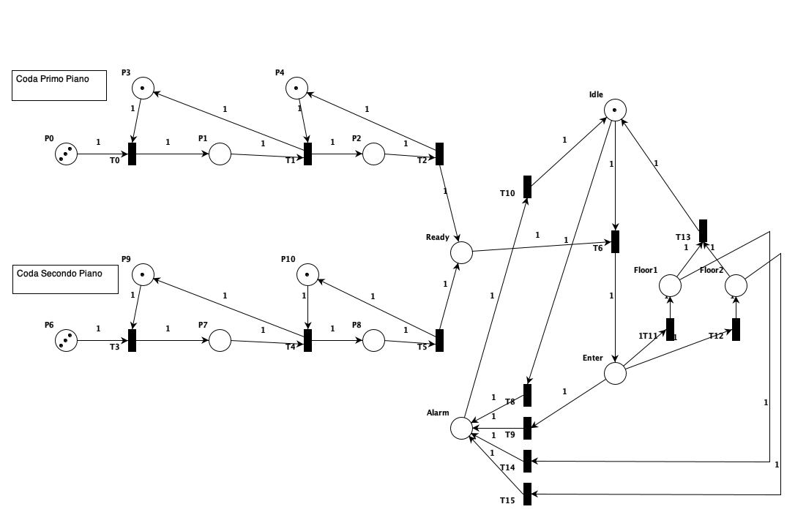

## FSP Model

### Overview

The system is the parallel composition of four kinds of processes:
- the users (`USER`)
- one ticket machine per floor (`TICKET_MACHINE`)
- one "now serving" screen per floor (`SCREEN`)
- the lift (`LIFT`)

The model is parametric:
- `N_FLOOR` is the number of floors, numbered `0..N_FLOOR-1`, where `0` is the ground floor.
- `M` is the number of tickets per floor, which is the queue capacity (up to M users per floor).
- `Users` is the set of users (`{a,b}` in the submitted file). Adding a user to this set is enough; the rest of the model adapts automatically.

### The lift

The lift is a single shared resource. It is modelled by the `LIFT` process and shared among all users. `LIFT` behaves as a lock. Once a user performs `acquire_lift[f]`, no other user can acquire the lift until it is freed by `release_lift` or by the alarm. This guarantees that the lift's capacity of one user at a time is respected.

The lift does not keep track of the floor it is on. Its movements are abstracted by the actions:
- `acquire_lift[f]`: the lift has arrived at floor `f` and the user has entered it.
- `press_button_floor[f]`: the user inside the lift selects the destination floor `f`. Any floor can be selected, including the current one.
- `release_lift`: the lift has reached the selected floor and the user has left it. The lift is now free again.

### Queue and FIFO policy

To get the lift, users on each floor must go through a queue. The queue is implemented as a ticket system, like the deli counter at a supermarket. Each floor `f` has two processes:
- **`TICKET_MACHINE(f)`** hands out tickets in increasing order through `get_ticket[f][t]`, with `t` in `0..M-1`. Taking a ticket models the user enqueing on floor `f`. After M tickets have been handed out, the machine stops (`END`).
- **`SCREEN(f)`** is the "now serving" display. It calls tickets in the same increasing order through `serving[f][t]`. It moves on to the next ticket only after the holder of the current ticket has performed `acquire_lift[f]`.

Tickets are issued and called in the same order, and the screen waits for each user to board. Together, this ensures that users on the same floor get the lift with a first-come-first-served (FIFO) policy. The queues are per floor: users waiting on different floors compete for the lift in a non-deterministic way.

### Users

A user's life cycle is:

1. **Enqueing on a floor:** `get_ticket[f][t]` takes ticket `t` on floor `f` and enters `USER_IN_QUEUE[f][t]`.
2. **Waiting in the queue:** the user waits until the screen shows their ticket (`serving[f][t]`).
3. **Boarding:** `acquire_lift[f]` takes the user to `USER_SELECTING`.
4. **Selecting the floor:** `press_button_floor[f]` takes the user to `USER_TRAVELLING`.
5. **Arriving:** `release_lift` takes the user back to `USER`.

The user process never terminates: after leaving the lift, the user can call it again. This makes the model easier to explore with the LTSA animator.

### Fire alarm

The alarm signal from the fire alarm system can interrupt the lift in any state:
- **Lift empty (`LIFT`):** the action `alarm_with_no_one_in`.
- **User inside (`SELECT_FLOOR`, `TRAVELLING`):** the action `alarm`. It synchronises with the user inside the lift (`USER_SELECTING` or `USER_TRAVELLING`) and interrupts their current activity.

In both cases the lift enters the `ALARM` state:
1. `travel_to_ground_floor`: the lift moves to the ground floor.
2. `open_door`: it opens the door and waits.
3. `resolved`: the external signal that the alarm has been solved is received.

The lift then returns to its initial state `LIFT`. While the lift is in `ALARM` it cannot be acquired, so users in the queues keep waiting.

As a simplification, a user inside the lift returns directly to the initial state `USER` when the alarm is raised. Leaving through the open door at the ground floor is not modelled explicitly.

### System composition

```
||SYSTEM = (Users:USER || Users::TICKET_MACHINES || Users::SCREENS || Users::LIFT)
           /{travel_to_ground_floor / Users.travel_to_ground_floor,
             open_door              / Users.open_door,
             alarm_with_no_one_in   / Users.alarm_with_no_one_in,
             resolved               / Users.resolved}.
```

- **`Users:USER`** creates one independent copy of the user process for each user (`a.USER`, `b.USER`).
- **`Users::`** (on `TICKET_MACHINES`, `SCREENS` and `LIFT`) creates a single shared copy of each resource. Any user can perform its actions, for example both `a.acquire_lift[0]` and `b.acquire_lift[0]`. This is what makes the lift, the ticket machines and the screens shared resources.
- **The relabelling** removes the user prefix from `travel_to_ground_floor`, `open_door`, `alarm_with_no_one_in` and `resolved`. These become single global events that all users see at the same time, rather than one copy per user. `alarm` keeps its prefix because it involves the specific user who is inside the lift.

### Properties

All properties were tested using LTSA tool with no LTL Property violations detected.

```
// Property 1
fluent USER_A_IN_LIFT[f:FLOORS] = <a.acquire_lift[f], {a.release_lift, resolved}>
fluent USER_B_IN_LIFT[f:FLOORS] = <b.acquire_lift[f], {b.release_lift, resolved}>

assert LIFT_MUTEX = forall[f:FLOORS] forall[ftwo:FLOORS] []!(USER_A_IN_LIFT[f] && USER_B_IN_LIFT[ftwo])

// Property 2
// from now on we pick "a" for example, all Users behave the same)
assert EVENTUALLY_ARRIVE = forall[f:FLOORS] forall[t:RM] [](a.serving[f][t] -> <> a.acquire_lift[f])

// Property 3
assert TRAVELLING = forall[f:FLOORS] [](a.press_button_floor[f] -> <> (a.release_lift || a.alarm))

// Property 4
assert FROM_QUEUE_TO_LIFT = forall[f:FLOORS] forall[t:RM] [](a.get_ticket[f][t] -> <> a.acquire_lift[f])
```

## Petri Net Model

The Petri net follows the same structure as the FSP model. Users wait in a FIFO queue on each floor, the lift is a lock shared by all users, and the alarm can interrupt the lift at any point.

To keep the net readable, it models a smaller instance of the system:
- two floors with a queue (first and second floor), each with a queue of two positions;
- three users waiting to call the lift on each floor;
- two destination floors.

Every token in the queue places represents a user.

### Queues and FIFO policy

Each queue is a chain of places, one per queue position. Each position is protected by its own lock place, so that only one token at a time can occupy that position.

### The lift

The lift states are places, and exactly one token is always in one of `Idle`, `Enter`, `Floor1`, `Floor2` or `Alarm`. Initially the token is in `Idle`. The places and transitions correspond to the states and actions of the FSP `LIFT` process.

`T6` (a user is entering in the lift) needs the single token in `Idle`, so only one user at a time can use the lift.

Unlike the FSP model, users do not return after a ride. `T6` merges the user token with the lift token, and the user leaves the system when the lift is released.

### Fire alarm

As in the FSP model, the alarm can be raised in every state of the lift:
- **`T8`**: from `Idle`, corresponding to `alarm_with_no_one_in`.
- **`T9`**, **`T14`**, **`T15`**: from `Enter`, `Floor1` and `Floor2`, corresponding to `alarm` with a user inside.

Here the alarm sequence of the FSP model (`travel_to_ground_floor`, `open_door` and waiting) is simplified into the single place `Alarm`. **`T10`** (`resolved`) models the external signal that the alarm has been solved. It moves the token from `Alarm` back to `Idle`, and the lift returns to service.

As in the FSP model, the user inside the lift is dropped when the alarm is raised. While the token is in `Alarm`, `T6` cannot fire, so users keep waiting in the queues and in `Ready`.


